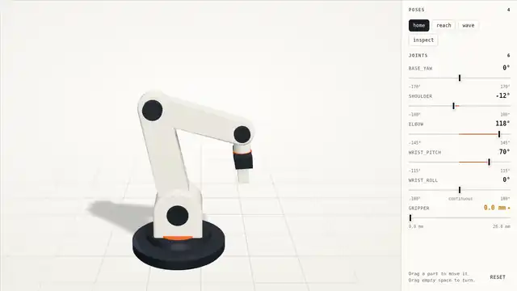

<p align="center"></p>

# robot-viewer

[](https://github.com/VinVirtual/robot-viewer/actions/workflows/test.yml) [](LICENSE)

Turn any URDF robot into one embeddable, self-hosted web component.

You give it a **URDF** (the standard robot description: links, joints, limits, and STL, OBJ or COLLADA meshes) and, if you like, a file of **named poses**. You get a `dist/` folder with one compressed `.glb` per robot, a `<robot-viewer>` custom element, a poster image, a demo page, the snippet to paste and a size report. Visitors can turn the robot, move every joint within its real limits, jump between poses with a smooth move, and drag a part of the robot to move it. Nothing is loaded from any other site, and it runs under the strictest usual policy, `Content-Security-Policy: default-src 'self'`.

It is packaged as a [Claude Code](https://claude.com/claude-code) skill (`SKILL.md` tells the assistant how to use it) and also works by hand from the command line.

Example: two robots on one demo page, [`examples/dist/`](examples/dist/) (serve the folder and open `index.html`). [Wren](examples/wren/) is made up for this repository; the [SO-ARM100](examples/so100/) is an open-source arm by The Robot Studio (Apache-2.0). Videos of the viewer in use: [`examples/media/wren-demo.mp4`](examples/media/wren-demo.mp4) and [`examples/media/so100-demo.mp4`](examples/media/so100-demo.mp4) (dark theme), each about 13 seconds, recorded by `robot-viewer record`.

```html
<script type="module" src="/robots/robot-viewer.js"></script>
<robot-viewer src="/robots/wren.glb" poster="/robots/wren.poster.webp" alt="Wren, a small desk arm" pose="home" ik></robot-viewer>
```

## How it works

1. **Read**: the URDF is parsed into links, joints, limits, mimic joints and visuals. Mesh paths are resolved only inside the URDF's folder or the package folder. `inspect` prints all of it.
2. **Convert**: STL, OBJ and COLLADA meshes are read with three.js loaders in Node, URDF boxes, cylinders and spheres are built, and [glTF Transform](https://gltf-transform.dev) writes **one GLB** whose node tree is the robot's: each link is a node, each joint is a node holding its fixed origin, and the joint's motion is the transform of the child link's node. The meshes are welded, quantized and compressed with **meshopt** (`EXT_meshopt_compression`). The joints, limits, mimic rules and poses are stored inside the GLB and written beside it as `<name>.joints.json`.
3. **Bundle**: esbuild builds two files. `robot-viewer.js` (about 5 KB gzipped) defines the element, shows the poster and waits. When the element comes within 200 px of the screen it imports `robot-viewer-engine.js` (about 174 KB gzipped: three.js, the viewer and the pure-JavaScript meshopt decoder).
4. **Poster**: the real component draws the robot in headless Chrome in its default pose, on a transparent background, saved as PNG and WebP. It is what visitors see first, and what stays when 3D is not possible.
5. **Check and report**: every page and script is checked for anything a strict policy blocks (inline scripts, handlers and styles, `eval`, WebAssembly, `blob:` URLs, other origins), and `verify` loads the demo page in Chrome under that header and counts violations. The size report gives bytes, gzip and brotli for every file against a budget.

### Why it works under `default-src 'self'`

| What usually breaks | What robot-viewer does |
|---|---|
| three.js from a CDN | bundled into `robot-viewer-engine.js`, served from your site |
| Draco and the usual meshopt decoder compile WebAssembly (needs `'wasm-unsafe-eval'`) and start workers from `blob:` URLs | meshopt with the **reference decoder** that ships with meshoptimizer, written in plain JavaScript: no WebAssembly, no workers |
| `<style>` and `style="..."` in components | styles go in through a constructed stylesheet (`adoptedStyleSheets`, which policies do not block), with `robot-viewer.css` as the fallback; values change through CSSOM |
| Textures turned into `blob:` URLs by GLTFLoader | the GLB carries material colours, no images, so that path never runs |
| Inline scripts on the demo page | none: `robot-viewer.js` and `demo.js` are files |

## The element

| Attribute | Meaning |
|---|---|
| `src` | the robot's `.glb` (from `build`) |
| `poster` | still image shown before 3D, and instead of it without WebGL |
| `alt` | what the robot is, for screen readers (also the 3D view's label) |
| `pose` | starting pose name (the build's default pose is used otherwise) |
| `orbit` | starting view, `"azimuth elevation"` in degrees |
| `controls` | `full` (poses and sliders, default), `poses`, or `none` |
| `ik` | let visitors drag a part to move it |
| `theme` | `light` or `dark`; without it the visitor's setting is followed |
| `grid` | `off` hides the floor grid (the shadow stays) |
| `loading` | `eager` loads 3D at once instead of when scrolled into view |
| `ar-glb`, `ar-usdz` | AR files; shows "View in your room" on phones that can open them |

JavaScript: `el.joints` (names, types, limits), `el.poses`, `el.values`, `el.setJoint(name, radiansOrMetres)`, `el.setJoints({...})`, `await el.goToPose(name, { animate })` (resolves `true` when it arrives, `false` if interrupted), `el.activate()`. Events: `load`, `joint-change` (`detail.values`, `detail.source`: `slider`, `pose`, `drag`, `api`), `pose-change`, `drag-end`, `fallback` (no WebGL), `error`.

Styling: CSS variables on the element, for example `robot-viewer { --rv-accent: #0a7f6f; --rv-aspect: 1 / 1; }`. The full list: `--rv-surface`, `--rv-stage`, `--rv-stage-glow`, `--rv-ink`, `--rv-muted`, `--rv-line`, `--rv-accent`, `--rv-accent-ink`, `--rv-warn`, `--rv-grid`, `--rv-shadow`, `--rv-radius-frame`, `--rv-radius-control`, `--rv-panel-width`, `--rv-aspect`, `--rv-aspect-wide`, `--rv-font`, `--rv-mono`. Parts for `::part()`: `frame`, `stage`, `panel`, `poster`, `status`, `start-button`, `ar-button`.

### Access and comfort

- Every joint is a native range input with a label, the value spoken in degrees or millimetres, and the limits printed under it. Arrow keys step half a degree (or half a millimetre); Home and End go to the limits; Page Up and Page Down take bigger steps. Pose buttons say which one is active (`aria-pressed`).
- The 3D view takes focus: arrow keys turn it, `+` and `-` zoom, Home resets.
- **Reduced motion**: the poster stays and a button opens the 3D view on request; poses then jump instead of moving, and the view does not drift after a drag.
- **No WebGL**: the poster stays with a short note. Nothing else is downloaded.
- **Lazy**: until the element is near the screen only the 5 KB loader and the poster load.
- A value within 4% of a limit turns amber with a ◆ mark.

## Install

```bash
git clone https://github.com/VinVirtual/robot-viewer ~/.claude/skills/robot-viewer
cd ~/.claude/skills/robot-viewer
npm ci

# optional: posters, the live CSP check and videos need Playwright and Chrome (or Chromium) with WebGL
npm i -g playwright-core
# if Google Chrome or Chromium is not installed:
npx playwright-core install chromium
# optional: videos need ffmpeg (apt install ffmpeg, brew install ffmpeg, or pip install imageio-ffmpeg)

./robot-viewer check
```

| Variable | Default |
|---|---|
| `PLAYWRIGHT_CORE` | `playwright-core` found locally or in the global npm folder |
| `ROBOT_VIEWER_CHROME` | installed Chrome, else Chromium, else Playwright's own |
| `FF` | `ffmpeg` on the PATH, else the one inside `imageio-ffmpeg` |

## Quick start

```bash
./robot-viewer inspect my-robot/urdf/robot.urdf
./robot-viewer build my-robot/urdf/robot.urdf --out public/robots --poses poses.json \
  --title "My arm" --alt "My arm, a six-joint desk robot" --base /robots/
./robot-viewer verify public/robots
```

Then paste the printed snippet into a page. To try the example: `examples/build.sh` (rebuilds both robots, checks them and records the videos), then serve `examples/dist` with any static server, for example `npx serve examples/dist` or `python3 -m http.server -d examples/dist`.

## Commands

```
robot-viewer check                        Node, packages, browser with WebGL, ffmpeg
robot-viewer inspect <urdf>               links, joints with limits, meshes found or refused   [--package dir] [--json]
robot-viewer build <urdf> --out <dist>    GLB + joints JSON + component + poster + demo page + snippet + size report
robot-viewer poster <dist> <name>         draw the poster again   [--pose name] [--orbit "az el"]
robot-viewer verify <dist>                static CSP check, then the live check in Chrome   [--static]
robot-viewer sizes <dist>                 size report   [--json] [--strict]
robot-viewer snippet <dist> [name]        the HTML to paste   [--base /robots/]
robot-viewer record <dist> <name> --out demo.mp4   a short video of the viewer in use   [--theme dark] [--width] [--height] [--fps]
robot-viewer test                         the tests
```

`build` options: `--poses file`, `--name` (file name, default from the robot's name), `--title`, `--alt`, `--package dir` (for `package://` paths), `--simplify 0.01..1` (share of vertices to keep), `--compress meshopt|none`, `--clamp` (pull pose values inside the limits instead of failing), `--no-ik`, `--ar-glb`, `--ar-usdz`, `--no-poster`, `--poster-pose`, `--orbit "az el"`, `--base /url/` (prefix in the snippet), `--verify` (run `verify` after), `--strict` (fail when a file is over budget). Build several robots into the same `--out`; they share the component and the demo page lists them all.

### Poses file

```json
{
  "units": "deg",
  "default": "home",
  "poses": {
    "home":  { "shoulder": -12, "elbow": 118, "wrist_pitch": 70 },
    "reach": { "base_yaw": 35, "shoulder": 58, "elbow": 48, "wrist_pitch": 30, "gripper": 0.022 }
  }
}
```

`units` is `deg` (default) or `rad`; sliding joints are always metres. Joints a pose leaves out are at 0 in it. `default` is the first pose shown, and the floor goes under the robot in that pose. The build refuses unknown joints (with a "did you mean"), fixed and mimic joints, non-numbers, names that are not short labels, more than 16 poses, and values outside the URDF limits (showing the limits in your units).

### Size report

Measured on the example (`examples/dist/size-report.txt`):

| File | Bytes | Gzip | Budget |
|---|---|---|---|
| `robot-viewer.js` (loader) | about 15.6 KB | about 5 KB | 10 KB gzipped |
| `robot-viewer-engine.js` | about 673 KB | about 174 KB | 200 KB gzipped |
| `wren.glb` (6,860 triangles) | 122 KB | | 4 MB |
| `so100.glb` (60,682 triangles, from 3.2 MB of STL) | 1.04 MB | | 4 MB |
| posters (`.webp`, 1200x900) | 27 KB and 59 KB | | 250 KB |

## AR

`robot-viewer` does not make AR files. The [ar-models](https://github.com/VinVirtual/ar-models) skill does: it converts a URDF in a chosen pose into a `.glb` for Android (Scene Viewer) and a `.usdz` for iPhone and iPad (AR Quick Look) at real-world size. Then:

```bash
ar convert robot.urdf --height 0.45 --pose "shoulder=-12deg,elbow=118deg" --out ar/
robot-viewer build robot.urdf --out dist --ar-glb ar/robot.glb --ar-usdz ar/robot.usdz
```

The files are copied into `dist/` as `<name>.ar.glb` and `<name>.ar.usdz`, and the element shows "View in your room" only on a phone that can open them (Quick Look on iOS, Scene Viewer on Android; nothing on desktops or in-app browsers). Scene Viewer needs the page on public `https`. See the ar-models README for real size and the MIME types. AR was not tested on phones for this repository.

## Honest limits

- **An interactive model, not a simulation.** No collisions, balance, torque, speed or contact are checked; parts can pass through each other. Joint limits from the URDF are the only rule. Drag-to-move uses cyclic coordinate descent: it moves the grabbed point toward the pointer as well as the joints above it allow, which is not how a real controller plans motion.
- **Meshes**: STL, OBJ and COLLADA, plus URDF boxes, cylinders and spheres. glTF, GLB and other mesh formats in a URDF are skipped with a warning. Image textures are not carried (colours are); OBJ material files are not read (the URDF colour is used).
- **Plain URDF only**: expand xacro first. SDF and MJCF are not read. `floating` and `planar` joints are shown as fixed. Closed loops are refused.
- **Colours**: URDF colours are taken as display (sRGB) values, as RViz shows them, and stored as linear glTF colours.
- The reference meshopt decoder is slower than the WebAssembly one. Decoding the 1 MB SO-ARM100 model took 22 to 43 ms in Node on the author's desktop; very large models (several million triangles) will decode slowly, so keep models under about 4 MB.
- The poster and the videos are rendered by Chrome's software renderer on machines without a GPU; recording runs at roughly 5 to 6 frames a second at 1280x720 on a 16-core desktop.
- Built and tested on Linux with Google Chrome. Firefox and Safari were not tested by the author.

## Files a robot description can reach

A URDF from someone else is untrusted input:

- Meshes are read only from inside the URDF's folder or the package folder, after following symbolic links, and only as `.stl`, `.obj` or `.dae`. Absolute paths, `file://`, `http(s)://` and paths that climb out with `..` are refused with the reason.
- XML with `DOCTYPE` or `ENTITY` declarations is refused (in the URDF and in COLLADA files). URDF files over 8 MB and meshes over 64 MB are refused.
- Names and titles are escaped in every generated page. Pose names must be short labels.
- The local server used for posters, `verify` and `record` listens on 127.0.0.1 only, answers only requests addressed to it, serves only the dist folder, and sends the strict policy header.

## Tests

```bash
./robot-viewer test     # or: npm test
```

128 tests: URDF parsing and its errors, limits and mimic joints, forward kinematics, the CCD solver (reach, limits, prismatic joints, mimic and locked joints, unreachable targets), pose validation, tween timing, mesh loading for all three formats, the GLB's node tree and joints description, decoding with the same pure-JavaScript decoder the browser uses, mesh path safety, AR link choice, the static CSP checker, every generated page and script passing it, the bundle size budget, the size report and the command line. Seven browser tests load the component in Chrome under `default-src 'self'` (no violations, lazy loading, keyboard sliders, smooth poses, reduced motion, no WebGL, drag-to-move); they are skipped when Playwright or WebGL is missing. The GitHub workflow installs `playwright-core` and uses the runner's Chrome.

## Licence

MIT, see [LICENSE](LICENSE). Third-party material and its licences are listed in [ASSETS.md](ASSETS.md): the SO-ARM100 files are Apache-2.0 (The Robot Studio), and the built component includes three.js and the meshoptimizer reference decoder (both MIT).
